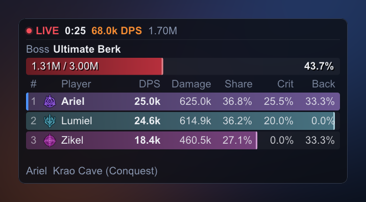

# AION 2 Combat Meter


[](https://github.com/mgauna-ar/aion2-combat-meter/releases/latest)
[](LICENSE)

**A lightweight, passive party DPS meter and combat overlay for AION 2 that draws directly on top of the game without modifying or injecting into it.**

The meter listens to incoming game network traffic on your PC (who hit what, with which skill, for how much) and displays real-time combat stats, aura tracking, network quality, and other players' combat power across customizable in-game overlays and a companion desktop app.

| Plugin | What it provides | Default |
|---|---|---|
| [⚔️ **Combat Meter**](plugins/combat_meter/README.md) | Full party DPS, HPS, and damage taken with per-skill breakdowns (crits, double hits, directional hits, blocks). Includes boss HP, live fight timers, combat timelines, death logs, buff uptimes, and saved encounter history. | **Enabled** |
| [✨ **Auras**](plugins/auras/README.md) | Tracks your personal and target buffs, debuffs, and estimated skill cooldowns as customizable bars or compact icons. Provides pop-up alerts for chain skill triggers, ready cooldowns, low HP warnings, or missing key buffs. | Disabled |
| [📶 **Ping**](plugins/ping/README.md) | Displays real-time server latency, jitter (RFC 3550), and a rolling 2-minute latency graph. Measured passively off server responses—the meter sends no network pings of its own. | Disabled |
| [🎯 **Combat Power**](plugins/combat_power/README.md) | Shows the combat power of the player you are fighting, and of the strongest players on the map with you: all of an arena's opponents or a dungeon's party. Read from what the game already sends as players come into view—nothing is looked up online. | Disabled |



[Quick start](#-quick-start) · [Account safety](#%EF%B8%8F-account-safety) · [Controls](#-controls) · [Troubleshooting](#-troubleshooting) · [Configuration](#%EF%B8%8F-configuration) · [Building](#-building-from-source)

---

## 🚀 Quick start

### 1. Install Npcap
Npcap is required to capture network packets locally (its license prevents bundling it):
- Download from **[npcap.com](https://npcap.com/)**.
- **Important installer settings:**
  - ✅ **Check:** *Support loopback traffic* (required if you use VPNs or ping reducers like ExitLag or GearUP).
  - ❌ **Uncheck:** *Restrict Npcap driver's access to Administrators only* (allows running the meter without administrator privileges).

### 2. Download the Meter
- Download `aion2-combat-meter-windows-x64.zip` from **[Releases](https://github.com/mgauna-ar/aion2-combat-meter/releases/latest)**.
- Extract the zip into its own folder where you have write permissions (e.g. `C:\Games\Aion2Meter` or Documents). Avoid `Program Files` so automatic self-updates can write to the directory.

### 3. Set Game to Borderless Windowed
In AION 2's display settings, set the window mode to **Borderless Windowed**.
*(Exclusive fullscreen prevents external overlay windows from displaying on top of the game).*

### 4. Run & Play
- Launch `aion2-combat-meter.exe`.
- Hit an enemy or training dummy—the combat overlay activates automatically when combat starts!
- To enable the Auras, Ping or Combat Power overlays, open the companion app window and toggle them on their respective pages.

> **Windows SmartScreen / Antivirus notice:** Because releases are compiled directly from source on GitHub Actions without a costly commercial code-signing certificate, Windows Defender or SmartScreen may show an initial warning. Click **More info → Run anyway**.

---

## ⚠️ Account safety

**Is this safe to use?**
Like most online games, AION 2's Terms of Service broadly prohibit unauthorized third-party software. Use any third-party tool at your own discretion.

However, the meter is engineered from the ground up to be **100% passive and completely non-intrusive**:
- 🚫 **Never touches the game process:** No process handle (`OpenProcess`), no reading or writing game memory, no DLL injection, and no API hooks (DirectX, system, or input hooks). It discovers the game connection solely through Windows' standard TCP table.
- 🚫 **Never sends network packets:** No packet injection (`pcap_sendpacket`, WinDivert) and no simulated keystrokes or mouse actions (`SendInput`). Npcap operates strictly in read-only mode, filtered to server traffic.
- 🪟 **Standard external desktop window:** Overlays are normal, transparent, click-through Windows desktop windows placed on top of the game (identical to Discord, OBS, or Steam overlays). Nothing is injected into the DirectX rendering pipeline.
- 🔒 **Zero telemetry:** The only outbound network call is an HTTPS check to GitHub on startup to check for new releases. No combat data, analytics, character names, or telemetry are ever uploaded.

Automated checks (`tools/check_forbidden_apis.sh`) run on every build and CI test to guarantee these passive invariants are never violated.

---

## 🎮 Controls

### Global Hotkeys
| Hotkey | Action | Details |
|---|---|---|
| `Ctrl+Alt+L` | **Lock / Unlock overlays** | When **unlocked**, drag the title bar or bottom-right grip to reposition and resize overlays. When **locked**, clicks pass through seamlessly to the game. |
| `Ctrl+Alt+H` | **Hide / Show meter** | Instantly toggles visibility of the Combat Meter overlay. |
| `Ctrl+Alt+R` | **Reset / End fight** | Immediately concludes the active encounter and saves it to your fight history. |

### Companion App Window
The companion app window opens on start and can be restored anytime by clicking the system tray icon:
- **Dashboard:** Live capture status, connected server IP, packet rates, manual capture recording, and quick folder links.
- **Plugin Pages:** Dedicated tabs for **Combat Meter**, **Auras**, **Ping**, and **Combat Power** to view detailed fight breakdowns, timeline charts, death logs, buff uptimes, and tweak overlay appearance.
- **Settings:** Adjust window preferences, *Start with Windows*, notification alerts, network capture port, and automatic update checks. All changes save automatically as you make them.
- **System Tray:** Closing the main window minimizes it to the tray. Right-click the tray icon to open folder locations, `config.json`, logs, or exit.

---

## 🩺 Troubleshooting

### Overlay does not appear over the game
1. **Display Mode:** Make sure AION 2 is running in **Borderless Windowed** (not exclusive fullscreen).
2. **Hidden or Locked:** Press `Ctrl+Alt+H` to ensure the overlay is not hidden, or press `Ctrl+Alt+L` to unlock overlays and bring them to the front.
3. **Visibility Settings:** By default, overlays may be set to show only in combat, only in dungeons, or only when the game is the foreground window. Unlocking overlays (`Ctrl+Alt+L`) forces them visible immediately so you can position them.
4. *Note for "Only in dungeons":* Requires passing through one loading screen after the meter starts so it can identify the current map.

### Meter stays on "WAIT" while in game
- **Ping Reducer or VPN (ExitLag, GearUP, LagoFast, etc.):** Game traffic travels through local loopback. Reinstall Npcap with **Support loopback traffic** checked, and ensure `capture.detect_relays` is `true`.
- **Custom Game Port or Executable:** Verify that the game executable is running as `Aion2.exe`. If connecting to an unlisted server port, record a packet capture to inspect the stream.

### Player names show as "#12345" or only your own damage appears
- **Character Names:** The game sends identity and name mappings during loading screens and teleports. Launch the meter *before* logging in or teleporting; until a loading screen is seen, your character is displayed as **You** and others appear by entity ID.
- **Party Members:** Outside a party in the open world, the server only transmits your personal combat events. When in a group or dungeon, launch the meter before forming or joining the party so the initial member roster packet is captured.

### "Npcap is not installed" or "Cannot open any adapter"
- If Npcap is missing, download and install it from [npcap.com](https://npcap.com/).
- If you see "Cannot open any adapter", Npcap was installed with administrator-only access. Reinstall Npcap with *Restrict Npcap driver's access to Administrators only* **unchecked**, or launch the meter as administrator.

### Encounter log says "Partial data"
On heavily crowded open-world bosses, the game server culls combat network packets and stops broadcasting every player's hits to nearby clients. The meter records all packets it received, but flags the encounter as partial data.

### Updating to new versions
A tray balloon and an **Update available** badge appear when a new version is released:
- Go to **Settings → Updates** and click **Update & restart**.
- The meter downloads the release, verifies its SHA-256 checksum against GitHub, swaps the executable, and restarts automatically (active fights in progress are preserved or cleanly closed).
- *Manual updates:* If running from a write-restricted location, you can unzip new releases directly over the existing folder.

---

## ⚙️ Configuration

Settings are stored in `%APPDATA%\aion2-combat-meter\config.json` and generated with defaults on first launch. The app window saves modifications automatically; edit the file manually only while the meter is closed.

### App Settings (`app`)

| Key | Default | Meaning |
|---|---|---|
| `open_window_at_start` | `true` | Open the app window on launch; if `false`, starts minimized to the system tray. |
| `close_to_tray` | `true` | Closing the app window minimizes it to the tray; if `false`, closes the application. |
| `notifications` | `true` | Show system tray notifications (capture failures, recording started, updates). |
| `check_for_updates` | `true` | Automatically check GitHub for newer releases on startup. **Check now** in Settings works either way. |
| `window_x`, `window_y` | `-1`, `-1` | App window position in pixels (`-1, -1` centers on screen). |
| `window_width`, `window_height` | `1280`, `760` | App window dimensions in pixels (clamped to at most 90% screen size). |

*(Note: "Start with Windows" is managed directly through Windows' User Run registry key rather than `config.json`)*.

### Capture Settings (`capture`)

| Key | Default | Meaning |
|---|---|---|
| `server_port` | `13328` | Target game server TCP port. |
| `game_process` | `Aion2.exe` | Game executable name used to locate the active connection in the TCP table. |
| `detect_relays` | `true` | Automatically detect and capture secondary TCP flows carrying game heartbeats (e.g. ping reducers and VPNs). |

### Plugin Settings
Each plugin's configuration options are stored in their respective sections and documented in their own guides:
- [⚔️ Combat Meter Configuration](plugins/combat_meter/README.md#configuration) (`meter`, `overlay`, `history`)
- [✨ Auras Configuration](plugins/auras/README.md#configuration) (`auras`)
- [📶 Ping Configuration](plugins/ping/README.md#configuration) (`ping`)
- [🎯 Combat Power Configuration](plugins/combat_power/README.md#configuration) (`combat_power`)

### Data & File Locations
All files are saved under `%APPDATA%\aion2-combat-meter\`:
- `history/`: Encounter data (individual fight JSON files and `index.jsonl`).
- `captures/`: Saved packet captures recorded from the app or tray.
- `meter.log`: Current application log (`meter.prev.log` holds the previous run).

---

## 🎥 Recording a capture

Packet captures help diagnose protocol changes, fix bugs, and add missing features.
> **Privacy Warning:** Captures contain character names. Share captures only with trusted contributors, and never commit them publicly (`.gitignore` excludes `*.pcap*`).

- **Via the Meter:** Click **Record** on the Dashboard, or choose **Record capture** from the system tray menu. Captures save to `%APPDATA%\aion2-combat-meter\captures\`.
- **Via Wireshark** (most complete):
  1. Capture simultaneously on your primary network interface and on "Adapter for loopback traffic capture".
  2. Set filter to `tcp port 13328`.
  3. Start capturing *before* logging in or teleporting (to capture character identity packets), and save as `.pcapng`.
  4. Note your character name and approximate hit values for validation.

---

## 🛠 Building from source

### macOS & Linux (Portable Core, Tests & Tools)
Requires Clang or GCC with C++20 support:

```bash
make test
```

`make test` compiles all components, verifies header self-containment, performs syntax checks, validates forbidden APIs, and runs all test suites against golden reference fights.

| Command | Purpose |
|---|---|
| `make tsan` | Runs all tests under ThreadSanitizer (race detection). |
| `make asan` | Runs all tests under AddressSanitizer and UndefinedBehaviorSanitizer. |
| `make replay` | Builds the standalone `./aion2meter-replay` CLI tool. |
| `make screenshots` | Re-renders documentation images in `docs/images/`. |
| `make fixtures` | Replays local captures in `tests/fixtures/local/` against their expected outputs. |

### Windows (Full Desktop Application)
Requires **Visual Studio 2022** (Desktop C++) and **CMake 3.22+**:

```bash
cmake -B build -A x64
cmake --build build --config Release
```

The compiled binaries are produced in `build\bin\Release\`:
- `aion2-combat-meter.exe`: The primary desktop meter and overlay.
- `aion2meter-replay.exe`: The standalone CLI capture replay and diagnostic tool.

### Replaying Packet Captures
Captures can be simulated through the meter without running the game or Npcap:

```bash
# Replay through the GUI overlay at real-time speed:
aion2-combat-meter.exe --replay fight.pcapng --speed 1

# Inspect reports from the CLI (skills, deaths, auras, casts, ping):
./aion2meter-replay capture.pcapng --fights
```

---

## 📡 Protocol

The meter decodes the server-to-client stream of TCP port 13328, which is transmitted unencrypted: framed opcodes, optional LZ4 compression blocks, server timestamp heartbeats, ping response packets, and the player records that carry each player's combat power.

All opcode definitions are cataloged in `src/protocol/include/protocol/opcodes.hpp`. For protocol specifications, wire layouts, and reverse engineering notes, see [AGENTS.md](AGENTS.md). These structures were identified from Global client research; all implementation code is written independently.

---

## License

This project is licensed under the **MIT License** — see the [LICENSE](LICENSE) file for details.

**Third-Party Components & Art:**
- **Dear ImGui:** Licensed under the MIT License (`src/third_party/imgui/LICENSE.txt`).
- **Icons:** Subset of [Lucide](https://lucide.dev) icons (ISC License), embedded via `tools/embed_icon_font.py`.
- **Game Data:** Skill names, dungeon maps, and NPC databases are sourced from aion2.app, effect names from questlog.gg (`src/game/data/*.tsv`).
- **Game Art:** Class emblems, skill icons and item icons are property of NCSOFT (served via aion2.app, bundled into `src/app/src/game_icon_sheet.inc`). The MIT License does not apply to NCSOFT game assets.
- **Application Mark:** The winged crystal icon was custom drawn for this project (`tools/gen_app_icon.py`) under the MIT License.

*AION 2 is a registered trademark of NCSOFT Corporation. This project is an independent community tool and is not affiliated with or endorsed by NCSOFT.*
