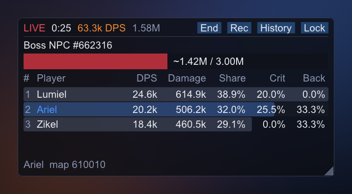
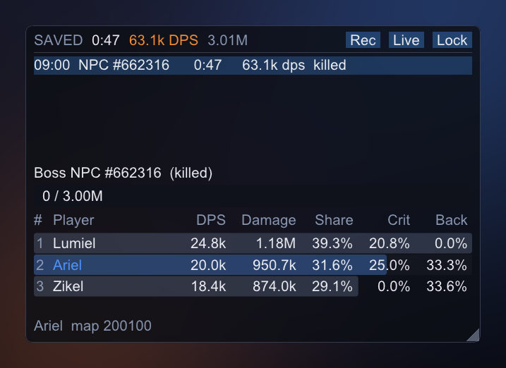

# AION 2 Combat Meter


[](LICENSE)

**A party DPS meter for AION 2 that draws on top of the game, without touching it.**

It reads the game's own network traffic as it reaches your PC, works out who hit what
for how much, and shows your party's damage, the boss's HP and the fight timer in a
small see-through window over the game. Boss fights are saved so you can look back at
them.



[Status](#-status) · [Account safety](#%EF%B8%8F-account-safety) · [Quick start](#-quick-start) ·
[Controls](#-controls) · [Configuration](#%EF%B8%8F-configuration) ·
[Troubleshooting](#-troubleshooting) · [Recording a capture](#-recording-a-capture) ·
[Building](#-building-from-source)

---

## 🚧 Status

Version 0.1. The decoder started from the community's notes on the Global client's
protocol and has been checked against one real capture: 30 seconds of open-world mobs.
That capture fixed the spawn and damage layouts and decoded the game's HP packet. More
captures are needed (`.claude/skills/decode-capture`), and these are still open:

- **Damage scale:** a mob's HP falls by a steady multiple of the damage number the meter
  reads (4.5 for one player, about 10.6 for others). The public meters count the same
  number with no multiple, so the totals match theirs; a check against the game's own
  meter is still to do.
- **Classes and skill names:** both come from the skill codes, with names from a public
  skill database (`src/meter/data/skills.tsv`). They have been checked against one
  capture, a Templar and an Elementalist.
- **Boss threshold:** an enemy with 1,000,000 max HP or more counts as a boss. That
  number is a guess (`meter.boss_min_max_hp`); open-world mobs have about 120,000.

## ⚠️ Account safety

**Third-party tools may break AION 2's terms of service. Use this at your own risk.**
NCSOFT has not approved any third-party meter, and its operation policy forbids
"unauthorized programs" in broad terms.

The meter is built to stay passive, and a check in the build fails if any code breaks
these rules:

- **It never opens the game.** No process handle is opened, no memory is read or
  written, nothing is injected and nothing is hooked. The game's connection is found
  through Windows' TCP table and a list of running processes, and neither of those opens
  a handle to the game.
- **It never sends anything.** No packets, no keystrokes, no mouse input. Npcap is used
  read-only, in non-promiscuous mode, filtered to the game server's side of the
  connection.
- **The overlay is an ordinary window.** It is a separate topmost window, like Discord's
  or OBS's. Nothing is drawn inside the game.

The meter makes no network connections of its own: no updates, no uploads, no
telemetry.

## 🚀 Quick start

1. **Install [Npcap](https://npcap.com/).** Tick **"Support loopback traffic"** so ping
   reducers and VPNs work too. Leave **"Restrict Npcap driver's access to
   Administrators only"** unticked, or the meter has to run as administrator. The
   licence does not allow bundling Npcap, so it is a separate install.
2. **Get the release.** Download `aion2-combat-meter-windows-x64.zip` from Releases,
   check it against `SHA256SUMS.txt`, and unzip it anywhere.
3. **Set the game to Borderless Windowed.** An exclusive fullscreen game hides every
   other window, this one included.
4. **Run `aion2-combat-meter.exe`.** It sits in the tray, and the overlay shows up in
   the top-left corner. Hit something.

The exe is not code-signed, so SmartScreen or antivirus software may warn about it.
Capture tools often get flagged. CI builds every release from source, and the zip's
SHA-256 is published with it.

## 🎮 Controls

| Hotkey | Does |
|---|---|
| Ctrl+Alt+L | Lock or unlock the overlay. Locked, clicks pass through to the game, and the overlay cannot be moved. |
| Ctrl+Alt+H | Hide or show the overlay. |
| Ctrl+Alt+R | End the current fight now. |

**While unlocked:**
- Drag the empty part of the header to move the overlay.
- Drag the corner grip to resize it.
- Use the header buttons: **End**, **Rec** (record a capture), **History** and **Lock**.
- Hover a row for that player's hits, crit and back-attack rates, and max hit.

**The app window** opens at start, and from the tray icon. Its sidebar has three pages:
- **Dashboard:** what the capture sees, recording, and the meter's files.
- **Combat Meter:** the live fight and the saved ones.
- **Settings:** the window, Start with Windows, notifications and the capture.

Changes are saved as you make them. Closing the window hides it to the tray (or quits,
with *Close to tray* off); starting the meter again while it runs opens it.

The tray icon's menu opens the window, does all of the above, and also opens the
history and recordings folders, `config.json` and the log.

**How fights are cut:**
- **Start:** a fight starts on the party's first hit on an enemy.
- **End:** it ends 2 s after the boss dies (so the last DoT ticks count), on a map
  change, or after 10 s without a party hit. While a boss is still standing, the wait
  is 30 s instead, to cover phases where it can't be hit.
- **Duration:** a fight's time runs from the first hit to the last, so the wait before
  a fight is called never lowers its DPS.
- **Saving:** boss fights and fights longer than 20 s are saved to the History tab.

**Who counts as party:**
- Out of a party, every player hitting enemies is listed.
- In a party, only its members are listed. Pets and summons count for their owner.



## ⚙️ Configuration

The settings live in `%APPDATA%\aion2-combat-meter\config.json`. The app window's
Settings pages edit them and save as you go; the file is written with defaults on
first run, and is also saved when you move, resize, lock or hide the overlay. Edit it
by hand only while the meter is closed. Out-of-range values are clamped.

**app**

| Key | Default | Meaning |
|---|---|---|
| `open_window_at_start` | true | Open the app window when the meter starts; off, it starts in the tray. |
| `close_to_tray` | true | Closing the app window hides it to the tray. Off, closing it quits. |
| `notifications` | true | Tray notifications: a capture that failed to start, a recording started. |
| `window_x`, `window_y`, `window_width`, `window_height` | -1, -1, 1280, 760 | The app window's position and size in screen pixels; -1, -1 centres it, at no more than 90% of the screen. |

*Start with Windows* is not in the file: Windows' Run key for your user is its only record.

**capture**

| Key | Default | Meaning |
|---|---|---|
| `server_port` | 13328 | The game server's TCP port. |
| `game_process` | `Aion2.exe` | The game's executable, used to find its connection. Third-party guides report this name; nothing official confirms it. If it is wrong, the meter still captures port 13328 on every adapter, but it cannot follow a ping reducer's relay. |
| `detect_relays` | true | Also watch other TCP flows for the game's heartbeat, for ping reducers and VPNs that relay the game on another port. |

**overlay**

| Key | Default | Meaning |
|---|---|---|
| `visible` | true | Shown at start. |
| `locked` | false | Click-through and fixed in place. |
| `opacity` | 0.80 | Background opacity, 0 to 1. Text stays opaque. |
| `scale` | 1.0 | Size, 0.6 to 2.5, on top of the monitor's DPI scaling. |
| `x`, `y`, `width`, `height` | -1, -1, 430, 250 | Position and size in screen pixels. -1, -1 places it near the top-left; other negative values are on a monitor left of or above the main one. |
| `show_share`, `show_crit`, `show_back`, `show_max_hit` | true, true, true, false | Optional columns. |

**meter**

| Key | Default | Meaning |
|---|---|---|
| `idle_timeout_s` | 10 | No party hit for this long ends a fight. |
| `boss_idle_timeout_s` | 30 | The same while a boss is still standing. |
| `capture_lost_s` | 15 | No game traffic for this long ends a fight. |
| `kill_grace_s` | 2 | Hits after the boss dies still count for this long. |
| `boss_min_max_hp` | 1000000 | Max HP that makes an enemy a boss. A guess until real captures calibrate it. |
| `min_saved_duration_s` | 20 | A fight with no boss is saved if it lasts at least this long. |
| `partial_damage_ratio` | 0.7 | A boss that dies having lost less than this share of its HP with hits the meter saw (by the game's own HP updates) marks the fight "partial data". |
| `wipe_detection` | false | End the fight when every party member is dead. Off until real captures show how revives look on the wire. |
| `memory_history` | 10 | Finished fights kept in memory. |

**history**

| Key | Default | Meaning |
|---|---|---|
| `max_fights` | 500 | Saved fights kept on disk; the oldest are deleted first. |

**Files the meter writes:**
- Saved fights: `%APPDATA%\aion2-combat-meter\history\`, one JSON file per fight plus
  `index.jsonl`.
- Recordings: `captures\`, in the same folder.
- The log: `meter.log`, in the same folder. The previous run's log is kept as
  `meter.prev.log`.

## 🩺 Troubleshooting

**The overlay says WAIT and "Npcap is not installed"**
Install Npcap (see Quick start), then restart the meter.

**It says "cannot open any adapter"**
Npcap was installed for administrators only. Reinstall it with that option unticked, or
run the meter as administrator.

**It says WAIT although I'm in game**
- **Ping reducer or VPN (ExitLag, GearUP and the like):** Npcap needs its loopback
  support (reinstall with it ticked). Also check `capture.game_process`.
- **Another port:** if the game moved off port 13328, record a capture in Wireshark
  and run `aion2meter-replay` on it. It lists every flow it decoded as the game.

**I can't see the overlay in game**
Use Borderless Windowed. If it is hidden, press Ctrl+Alt+H.

**My party shows as #12345 instead of names**
The game sends names mostly on loading screens. Start the meter before you log in or
teleport, and the names will appear after the next loading screen. Until then your own
row shows as **You**.

**The boss fight says "partial data"**
On crowded world bosses the server stops sending most players' hits, so the meter
cannot see the whole fight. Only the hits it did see are counted.

## 🎥 Recording a capture

A capture of the game's traffic is how the decoder gets fixed and checked: replay it on
any PC with `aion2meter-replay`. **Captures hold character names. Share them only with
people you trust, and never commit them** (`.gitignore` blocks `*.pcap*`).

**From the meter:** click **Rec** in the overlay or choose **Record capture** in the
tray menu. The file goes to `%APPDATA%\aion2-combat-meter\captures\`.

**With Wireshark (most complete):**
1. Capture on both your network adapter and "Adapter for loopback traffic capture",
   with the capture filter `tcp port 13328`.
2. Start before you log in or teleport, because names arrive on loading screens.
3. Save as pcapng.
4. Write down what you know: your character's name, a few hit numbers you saw, and when
   the boss died.

## 🛠 Building from source

**macOS or Linux (the portable core, tests and tools):**

```bash
make test
```

That runs:
- the unit tests;
- a compile of every header on its own;
- an ImGui syntax check of the overlay;
- the forbidden-API check;
- a replay of a made-up boss fight against `tests/golden/synthetic_fights.txt`.

Other targets:

| Target | Does |
|---|---|
| `make tsan` | The tests under ThreadSanitizer. |
| `make asan` | The tests under AddressSanitizer and UBSan. |
| `make replay` | Builds `./aion2meter-replay`. |
| `make fixtures` | Replays your own captures in `tests/fixtures/local/` and diffs each against its `.expected.txt`. |
| `make screenshots` | Re-renders `docs/images` from the overlay's own drawing code. Needs zlib; set `SHOTS_FONT` off macOS. |
| `make golden` | Rewrites the replay smoke test's reference after an intended change. |

**Windows (the app):** Visual Studio 2022 and CMake 3.22 or newer.

```bash
cmake -B build -A x64
```

```bash
cmake --build build --config Release
```

`build\bin\Release\` then holds `aion2-combat-meter.exe` and `aion2meter-replay.exe`.

You can also run the meter on a capture instead of live traffic, at recorded speed. It
works without the game or Npcap:

```bash
aion2-combat-meter.exe --replay fight.pcapng --speed 1
```

**The replay tool** runs a capture through the same pipeline as the live meter:

```bash
./aion2meter-replay capture.pcapng --fights --events --opcodes
```

| Option | Prints |
|---|---|
| `--fights` | A table per fight. |
| `--skills` | The fight tables, and each player's skills, healing and damage taken. |
| `--events` | Every decoded event. |
| `--opcodes` | Counts and sizes per opcode. |
| `--unknown` | Hex dumps of anything the parser does not read or failed on. |
| `--dump 0438,4136` | Hex dumps of those opcodes. |
| `--anonymize` | Every name as `#id`, for output you will share. |

`build/synth/aion2meter-synth out.pcapng` writes the made-up boss fight the tests use,
with invented names, so you can try everything without the game.

## 📡 Protocol

The meter decodes the server's side of the game connection: TCP port 13328.
- **Encryption:** none on this side. The client's side is encrypted, and the meter
  ignores it.
- **Framing:** each frame is a varint length, an optional flag byte, a 2-byte opcode and
  a body. Some frames are LZ4 bundles of more frames.
- **Heartbeat:** about twenty a second. It carries the server clock, and the decoder
  uses it to find frame boundaries again after lost packets.
- **Where the details live:** `src/protocol/include/protocol/opcodes.hpp` holds the
  opcodes. `AGENTS.md` describes the layouts and lists what is still unknown.

These facts come from the AION 2 community's published notes on the Global client. The
decoder and everything else here are written from scratch, and no code is taken from
the GPL meters.

## License

MIT, see [LICENSE](LICENSE). Dear ImGui is MIT (`src/third_party/imgui/LICENSE.txt`).
AION 2 is a trademark of NCSOFT. This project is not affiliated with NCSOFT.
