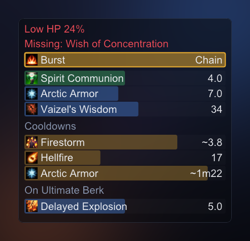
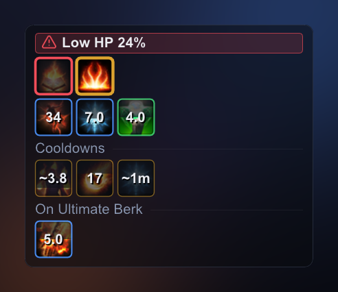
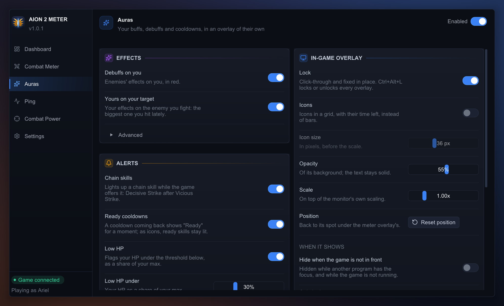

# ✨ Auras

**Your buffs and debuffs, yours on the enemy you fight, and your cooldowns, as bars or
icons in an overlay of their own, with alerts: a chain skill on offer, a cooldown back,
your HP running low, a buff you watch for missing.** One of the meter's four plugins
(the others are the [Combat Meter](../combat_meter/README.md), [Ping](../ping/README.md) and
[Combat Power](../combat_power/README.md)). Off until you switch it
on, at the top right of the app window's **Auras** page; switching it on shows its
overlay.

## The overlay

A window of its own, which you place like the meter's (unlock with Ctrl+Alt+L, drag, resize).
**Alerts** come first:
- **Low HP:** a pulsing red "Low HP 23%" while your HP is under the threshold you set
  (30% of your max by default). Your max is the game's own figure, sent at login and
  on each loading screen.
- **Missing:** a buff on your watch list that is not on you (below).
- **Chain skills:** while the game offers you a chain skill (Decisive Strike after
  Vicious Strike), it lights up, gold, until you use it or the offer runs out (about
  3 s). The game says when the offer ends, not how long it lasts, so it has no timer.

Then, as bars:
- **Your effects:** each is a bar, led by the icon of the skill behind it, showing what
  share of its time is left, with the seconds on the right. A monster's effect has no
  icon. Green bars are an ally's buffs, blue ones yours, red ones an
  enemy's debuffs. Stacks show as "x2".
- **Your cooldowns:** amber bars under "Cooldowns", each with its skill's icon, and "~"
  on an estimate. A skill coming back shows a green "Ready" bar for a moment. A skill
  with a second use ("+1 consecutive use") shows only once both are spent.
- **Yours on your target:** under "On <enemy>": the biggest enemy you (or your summons)
  hit in the last 10 seconds, so in a boss fight with adds, the boss.
- **The watch list:** the page's *Watch list* lists every buff seen on you this session.
  A buff you switch on there shows as a red "Missing: <name>" line while it is not on
  you: a Chanter's mantra, say.
- **What it leaves out:** effects shorter than a second (a dodge's mark), and passives'
  effects, which never end. Both are settings.
- **Hiding it:** locked, it can hide while the game is not in front, and outside
  dungeons, by its own settings. It has no "only in combat": buffs matter between
  fights too.

**Or as icons** (the page's *Icons* switch), as the game draws its own effects: a grid
of tiles that wraps to the window, 36 px by default. An effect's tile is framed in its
colour, darkens as it runs out, and shows its time left and its stacks. Your cooldowns
sit in a fixed order, like an action bar: dim with the time left while cooling, lit
when ready, glowing as they come back. A missing watched buff is its icon dimmed in a
pulsing red frame, and a chain skill on offer its icon in a pulsing gold one.

## How exact it is

- **Effects** come with the server's own durations and end times, so their bars are
  exact. About four in five have a name from the skill table; monster, item and system
  effects show as "Effect <number>".
- **Chain skills** and **your HP** are the game's own: it says when an offer starts and
  ends, and what your HP and max HP are.
- **Cooldowns** are estimates, marked "~": the server sends none when you use a skill.
  The plugin starts from aion2.app's figure less the specialties you picked, and
  shortens it to your quickest reuse as you play (that is where your cooldown
  reduction shows). Over 274 uses on a dungeon capture, no estimate ran more than
  0.65 s long. When the server does say what is left (after a cut or a reset), the bar
  is exact.
- **Switched off**, it forgets what it knew. Switched back on, it fills in as effects
  come: on the next loading screen, every passive's effect is sent again.

## Configuration

Its keys live in `%APPDATA%\aion2-combat-meter\config.json`, beside the app's
([README, Configuration](../../README.md#%EF%B8%8F-configuration)). The page edits them
and saves as you go.

**auras**

| Key | Default | Meaning |
|---|---|---|
| `plugin_enabled` | false | The plugin's switch, which shows and hides its overlay. A file from 0.2.0, which has none, takes its `visible` instead. |
| `locked` | false | Click-through and fixed in place. |
| `opacity` | 0.55 | Background opacity, 0 to 1. Bars and text stay opaque. |
| `scale` | 1.0 | Size, 0.6 to 2.5, on top of the monitor's DPI scaling. |
| `x`, `y`, `width`, `height` | -1, -1, 280, 300 | Position and size in screen pixels. -1, -1 places it under the meter overlay's default spot. |
| `show_debuffs` | true | Enemies' effects on you. |
| `show_target` | true | Your effects on the enemy you fight. |
| `show_permanent` | false | Effects that never end: passive skills' and the ones a login puts on. |
| `min_duration_s` | 1.0 | Effects shorter than this are left out, 0 to 60. |
| `show_cooldowns` | true | Your cooldowns, estimated. |
| `min_cooldown_s` | 3.0 | Cooldowns shorter than this are left out (Dodge's, a combo's), 0 to 120. |
| `icons` | false | Icons in a grid instead of bars. |
| `icon_size` | 36 | An icon's side in pixels, 20 to 64, on top of `scale`. The game's icons are 40 px; larger ones are stretched. |
| `show_chains` | true | Light up a chain skill while the game offers it. |
| `show_ready` | true | A cooldown coming back shows "Ready" for a moment; as icons, ready skills stay lit. |
| `low_hp_alert` | true | Flag your HP under `low_hp_percent`. |
| `low_hp_percent` | 30 | Of your max HP, 5 to 90. |
| `watch` | `[]` | Effects to flag while they are not on you: the skill codes the *Watch list* stores, at most 64. |
| `hide_when_game_unfocused` | false | Hide it while neither the game nor the meter's window is in front, and while the game is not running. Applies only while locked. |
| `show_in_dungeons_only` | false | Show it only in a dungeon (as the meter overlay's setting of that name). Applies only while locked. |

## For developers

How it decides who is who, which enemy is the target, and how the cooldowns are
estimated is in this plugin's [`AGENTS.md`](AGENTS.md). `aion2meter-replay --auras`
prints every effect put on and taken off, your skill uses and cooldown changes, and
your chain skills offered and withdrawn.
