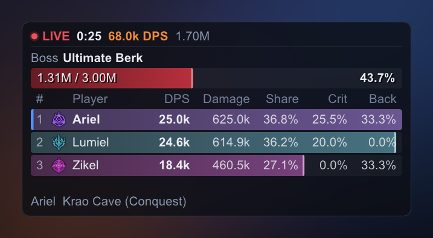
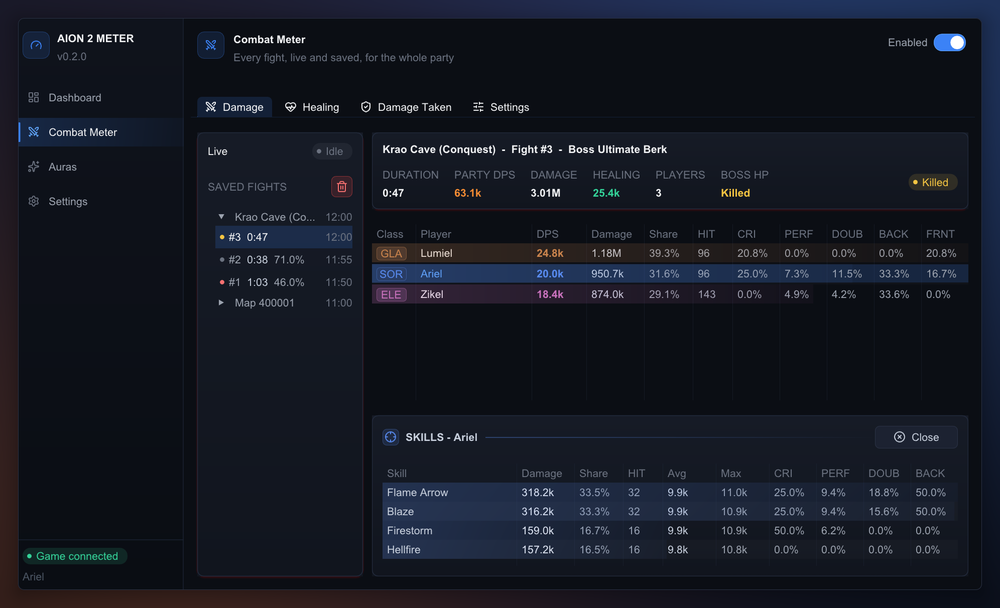
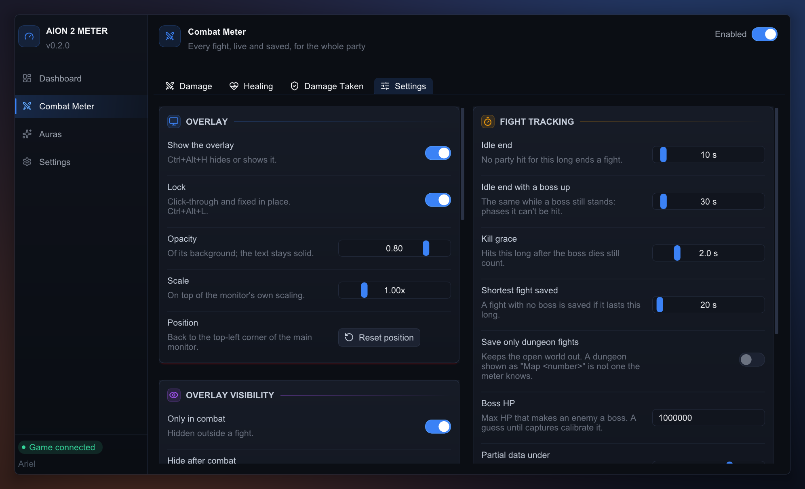

# ⚔️ Combat Meter

**The party's DPS, healing and damage taken, fight by fight: live on an overlay, and in
detail in the app window.** One of the meter's two plugins (the other is
[Auras](../auras/README.md)). On by default; its switch is at the top right of its
page.

It shows what the game's own Combat Analysis window (Ctrl+X) shows, but for every party
member: damage, hit counts, crit, perfect, double, back and front rates for each player
and each of their skills; healing; damage taken; and every saved fight, grouped by visit
to a map, one entry per dungeon run.

## The overlay

The overlay shows the live fight only: the party ranked, the boss's HP and the timer.
Saved fights and every setting are on the app window's **Combat Meter** page.

**While unlocked** (Ctrl+Alt+L):
- Drag the empty part of the header to move the overlay.
- Drag the corner grip to resize it.
- Use the header buttons: **End**, **App** (open the app window) and **Lock**.
- Hover a row for that player's hit rates, healing and max hit.

**Hotkeys:** Ctrl+Alt+H hides or shows it; Ctrl+Alt+R ends the current fight now.

**Hiding it:** under Combat Meter > Settings, the overlay can show only in combat
(staying up a few seconds after, 5 by default), only in dungeons, and hide while the
game is not in front. They apply only while it is locked, so an unlocked overlay can
always be found and dragged back. Switching the plugin off hides it too.

## How fights are cut

- **Start:** a fight starts on the party's first hit on an enemy. Breaking a boss's trap
  around a party member (1 damage a hit) counts for nothing, as in the game's own window.
- **End:** it ends 2 s after the boss dies (so the last DoT ticks count), on a loading
  screen (entering the same dungeon again too), or after 10 s without a party hit.
  While a boss is still standing, the wait is 30 s instead, to cover phases where it
  can't be hit. Switching the plugin off ends it too.
- **Duration:** a fight's time runs from the first hit to the last, so the wait before
  a fight is called never lowers its DPS.
- **Saving:** boss fights and fights longer than 20 s are saved, and listed on the
  Combat Meter page, grouped by map visit: each run of a dungeon is its own entry, and
  a teleport or revive inside a run stays in it. *Save only dungeon fights* keeps the
  open world out.

## Who counts as party

- In a party, only its members are listed. Pets and summons count for their owner.
- Out of a party, only you are listed in the open world, so a crowd at a world boss
  stays out. In a dungeon only your group can be there, so every player is listed.
- Your own row always shows on the overlay: when you rank below the rows it shows, you
  take the last one, with your rank.
- Healing between two players counts only when it lands on the party, since a PvP hit
  looks the same.

## Configuration

Its keys live in `%APPDATA%\aion2-combat-meter\config.json`, beside the app's
([README, Configuration](../../README.md#%EF%B8%8F-configuration)). The page edits them
and saves as you go.

**meter**

| Key | Default | Meaning |
|---|---|---|
| `plugin_enabled` | true | The plugin's switch. Off, it reads nothing, saves nothing and hides its overlay; its saved fights stay. |
| `idle_timeout_s` | 10 | No party hit for this long ends a fight. |
| `boss_idle_timeout_s` | 30 | The same while a boss is still standing. |
| `capture_lost_s` | 15 | No game traffic for this long ends a fight. |
| `kill_grace_s` | 2 | Hits after the boss dies still count for this long. |
| `boss_min_max_hp` | 1000000 | Max HP that makes an enemy a boss. One dungeon's bosses had 5.2M–9.9M, its trash under 450,000. |
| `min_saved_duration_s` | 20 | A fight with no boss is saved if it lasts at least this long. |
| `save_only_dungeons` | false | Save only fights in a dungeon, as `overlay.show_in_dungeons_only` tells them. A dungeon the meter cannot name (its fights read "Map <number>") counts as not one. |
| `partial_damage_ratio` | 0.7 | A boss that dies having lost less than this share of its HP with hits the meter saw (by the game's own HP updates) marks the fight "partial data". |
| `wipe_detection` | false | End the fight when every party member is dead. Off until real captures show how revives look on the wire. |
| `memory_history` | 10 | Finished fights kept in memory. |

**overlay**

| Key | Default | Meaning |
|---|---|---|
| `visible` | true | Shown at start. |
| `locked` | false | Click-through and fixed in place. |
| `opacity` | 0.80 | Background opacity, 0 to 1. Text stays opaque. |
| `scale` | 1.0 | Size, 0.6 to 2.5, on top of the monitor's DPI scaling. |
| `x`, `y`, `width`, `height` | -1, -1, 430, 250 | Position and size in screen pixels. -1, -1 places it near the top-left; other negative values are on a monitor left of or above the main one. |
| `show_share`, `show_crit`, `show_back`, `show_max_hit` | true, true, true, false | Optional columns: share of the damage, crit, back-attack rate, biggest hit. |
| `show_hits`, `show_perfect`, `show_double`, `show_front`, `show_multi`, `show_block`, `show_heal` | false | More optional columns: hits, perfect and double rates, front-attack rate, multi-hit and blocked rates, healing. |
| `class_bars` | true | Bars in each player's class colour; off, all in one colour. |
| `max_rows` | 8 | Players shown, best first, 1 to 24. Your own row is always one of them. |
| `show_in_combat_only` | false | Show the overlay only during a fight, and for `hide_after_combat_s` after it. Applies only while locked. |
| `hide_after_combat_s` | 5 | Seconds it stays up after a fight, to read the result. |
| `hide_when_game_unfocused` | false | Hide it while neither the game nor the meter's window is in front. Applies only while locked. |
| `show_in_dungeons_only` | false | Show the overlay only in a dungeon: one of `src/game/data/maps.tsv`'s dungeon tiers. Hidden in the open world, the Abyss, battlefields, and before the first loading screen. Applies only while locked. |

**history**

| Key | Default | Meaning |
|---|---|---|
| `max_fights` | 500 | Saved fights kept on disk; the oldest are deleted first. |

**Saved fights** go to `%APPDATA%\aion2-combat-meter\history\`, one JSON file per fight
plus `index.jsonl`. The trash button on the page deletes them.

## For developers

The rules it keeps (sides, the boss, fight ends, the history) are in this plugin's
[`AGENTS.md`](AGENTS.md).
