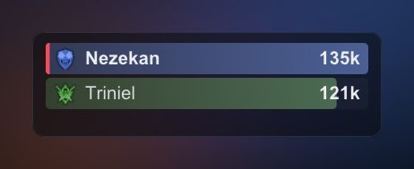
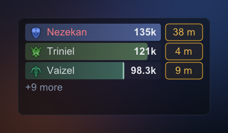
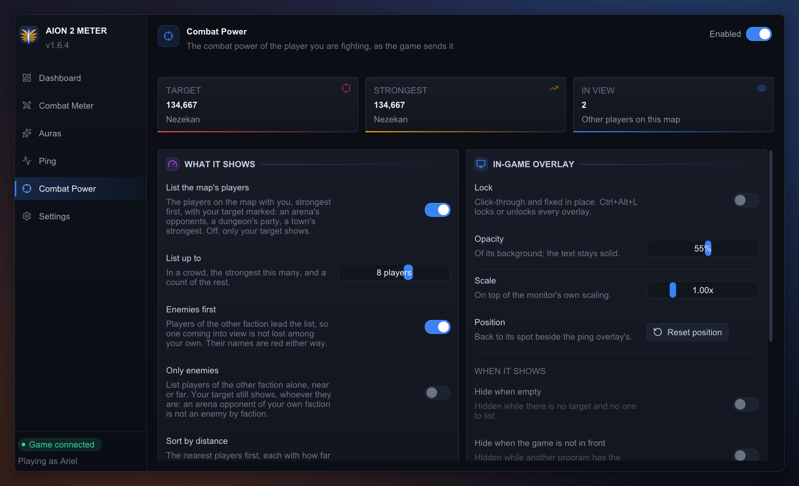

# 🎯 Combat Power

**The combat power of the player you are fighting, and of the strongest players on the
map with you, in an overlay of their own.** One of the meter's four plugins (the
others are the [Combat Meter](../combat_meter/README.md), [Auras](../auras/README.md)
and [Ping](../ping/README.md)). Off until you switch it on, at the top right of the app
window's **Combat Power** page; switching it on shows its overlay.

## The overlay

A fourth window you place like the meter's (unlock with Ctrl+Alt+L, drag, resize).
- **In an arena or a dungeon:** every other player on the map, strongest first, each
  with their class emblem, their name and their combat power, shortened to three
  figures (135k for 134,667; the app's page gives it whole). An arena's opponents
  show as the match loads, before the first hit. The bars compare each player with
  the strongest.
- **Your target** is the player you last used a skill on, for half a minute after it.
  In the list, their row carries a red stripe and a bold name. Hitting an enemy makes
  them your target too; a heal that lands on an ally (a passive's, a spirit's) does
  not move it.
- **In a crowd** (a town, the open world) the list is the strongest players in your
  view, as many as **List up to** (8 unless you change it), with
  "+N more" under them. A target who is not among them shows on a line of their own
  above the list.
- **Players leave the list as they leave your view:** when they walk out of range,
  or a second or two after they die. The game says so, and sends them again if they
  come back.
- **A player who dies** fades in the list until they are gone, and an enemy stops
  leading it.
- **Enemies come first, in red.** An enemy has a red name and leads the list, ahead
  of everyone else. One of the other faction, or of the other side in the Abyss, is
  marked from the moment they come into view, before they have done anything;
  anyone else from the first skill between you. See below for who counts as an
  enemy.
- **Sorted by distance** (a switch on the page, off unless you turn it on) the list
  is the nearest players instead, each with how far they are in metres, in a yellow
  badge right of the bars; it fades when it is more than 5 s old (see below). The bars
  still compare combat power. See below for what the distance is measured from.

- **Only enemies** (a switch on the page, off unless you turn it on) lists enemies
  alone: every one in view, near or far, the ones within 200 m first, a dead one
  dimmed until they leave. Your target still shows, whoever they are, on a line of
  their own when they are not an enemy (a member of your party). "+N more" then
  counts enemies.
- **Hide when empty** (with the overlay's other conditions) hides it, while locked,
  when it has no one to show: no target, and no one in the list. With "Only
  enemies", it stays out of the way until an enemy comes into view.
- **A class emblem** appears once that player has used a skill: the game does not say
  the class, their skills do.
- **"-"** means that player's record carried no figure the plugin could read.
- **Not shown:** your own combat power. The game does not send you yours the way it
  sends everyone else's.
- **Hiding it:** locked, it can hide while the game is not in front, and outside
  dungeons, by its own settings. An arena is not a dungeon, so leave "Only in
  dungeons" off if you want it there.

## Where the figure comes from, and how exact it is

**Nothing is sent, and nothing is looked up.** The meter stays passive.
- **The game sends it.** As a player comes into view, the server sends your game their
  whole record: name, looks, gear, and their combat power, the figure their character
  page shows. The plugin reads it there.
- **It is as fresh as that record.** A player who changes gear while you watch shows
  the old figure until the game sends them again (a new map, or coming back into
  view).
- **Checked against public character pages:** of four players of one capture, two
  matched their page to the point; the other two were within 0.3% and 25% (a
  level-11 character, levelling) of pages read some hours later.
- **Players already beside you when the meter starts** are not known until the game
  sends them again: start the meter before you log in or queue.
- **Switched off**, it forgets what it knew.

## Who counts as an enemy

- **The other faction.** Every player's record says which of the two factions they
  are, and so does yours. A player whose faction is not yours is an enemy.
- **In the Abyss, the other side, whatever the faction.** The Abyss can pair your
  faction against itself (Elyos against Elyos). There every player's record also
  says which side they fight on, and so does yours: one on the other side is an
  enemy from the moment they come into view, and one on yours is not, whatever
  their faction. In one such match the only player of the other side turned red two
  seconds before their first skill landed on you.
- **Anyone who fights you or your party.** A skill they use on you or a member of
  your party, or you or a member on them, marks them, whatever their faction, until
  you change map: an arena opponent of your own faction, for one. The game sends
  heals and buffs as cast on the healer, never aimed at another player, so a skill
  aimed at a player is taken for an attack. A passive going off, or a skill between
  two others, marks no one.
- **Never your party, and not by faction in a dungeon.** A member of your party is
  never marked, whatever their faction or side. Dungeon parties mix both factions,
  so the faction marks no one there. An arena or a battlefield is no such dungeon:
  the other faction there is marked.
- **Rifts: War Mode is not read yet.** In a rift, a player of the other faction with
  War Mode off cannot attack you or be attacked, but is marked all the same: how the
  game says another player's War Mode has not been found yet.
- **Out of reach, they lose their place, not their colour.** An enemy more than
  200 m from where you last used a skill stops leading the list, as does one who is
  dead. Their name stays red.
- **Until the game has sent your own record** (the meter started while you were
  already on a map) your faction and your side are not known, and no one is marked
  by them: only by a fight. They come with the next map.
- "Enemies first" on the page turns the ordering off; the red names stay.

## How distance is measured, and where it falls short

- **Other players:** the game sends where each one is as they come into view and
  with every step they take, flying included, so their side is current.
- **You:** the game never sends you your own steps. The plugin knows where you are
  from your own record as you enter a map, from every effect you cast (it carries
  where you stood), and from a skill that moves you, such as a charge.
- **So it is exact while you fight** (in one arena match your position came several
  times a second) **and stale while you only walk or fly:** distances are then
  measured from where you last used a skill.
- **A stale position shows "?"** in each distance's badge, and the list goes back to
  strongest first: 5 seconds after your last skill on foot, and 1 second after it
  when you were moving faster than a run. Flying the Abyss's Flight Circles you
  cover 100 metres in two seconds, and a number from where you were would put an
  enemy beside you that far away. Use any skill and the distances are back.
- **An enemy leads the list at any distance** while your position is stale, as
  when it is not known: the 200-metre range needs to know where you are.
- **Until your position is known** (the meter started while you stood somewhere, and
  you have not used a skill since) the list stays strongest first, with no
  distances.
- A metre is 100 of the game's units; height counts.

## Configuration

Its keys live in `%APPDATA%\aion2-combat-meter\config.json`, beside the app's
([README, Configuration](../../README.md#%EF%B8%8F-configuration)). The page edits them
and saves as you go.

**combat_power**

| Key | Default | Meaning |
|---|---|---|
| `plugin_enabled` | false | The plugin's switch, which shows and hides its overlay. |
| `locked` | false | Click-through and fixed in place. |
| `opacity` | 1.0 | The whole overlay's opacity, 0.2 to 1: its panel, names and figures fade together. |
| `background_opacity` | 0.55 | The panel's alone, 0 to 1, behind the names and figures. A file from before 1.13, with `opacity` and no `background_opacity`, has its `opacity` read as this. |
| `scale` | 1.0 | Size, 0.6 to 2.5, on top of the monitor's DPI scaling. |
| `x`, `y`, `width`, `height` | -1, -1, 260, 190 | Position and size in screen pixels. -1, -1 places it right of the ping overlay's default spot. |
| `show_list` | true | List the map's players, strongest first. Off, only your target shows. |
| `enemies_first` | true | Enemies (Who counts as an enemy, above) lead the list while within 200 m. Off, the list is the strongest (or the nearest) of everyone. Their names are red either way. |
| `only_enemies` | false | List only enemies, near or far, alive or dead. Your target shows whoever they are. |
| `sort_by_distance` | false | List the nearest players first, each with its distance, instead of the strongest. |
| `list_max_players` | 8 | The most players listed, 1 to 12. With more on the map, these are the strongest (the nearest, with `sort_by_distance`), and a count of the rest follows. |
| `hide_when_game_unfocused` | false | Hide it while neither the game nor the meter's window is in front, and while the game is not running. Applies only while locked. |
| `show_in_dungeons_only` | false | Show it only in a dungeon (as the meter overlay's setting of that name): an arena or a battlefield is one, Chaotic Reshanta is not. Applies only while locked. |
| `hide_when_empty` | false | Hide it while it has no one to show: no target and an empty list. Applies only while locked. |

## For developers

The rules are in this plugin's [`AGENTS.md`](AGENTS.md). `aion2meter-replay --events`
prints `cp N` on every player record that carried a combat power.
