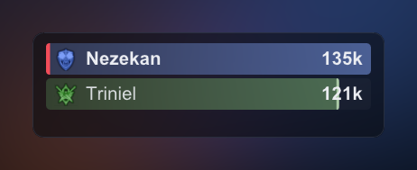
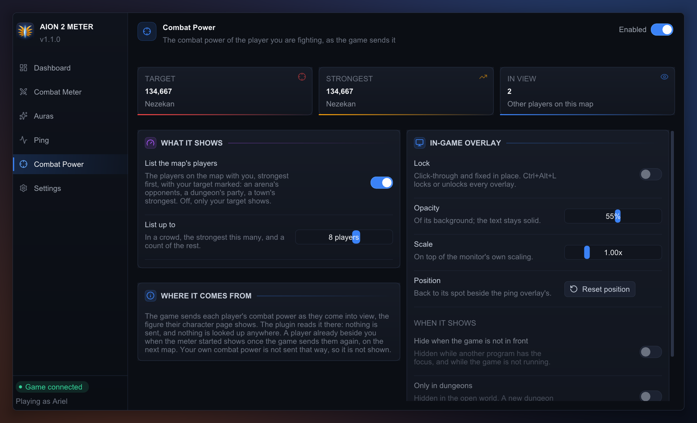

# 🎯 Combat Power

**The combat power of the player you are fighting, and of the strongest players on the
map with you, in an overlay of their own.** One of the meter's four plugins (the
others are the [Combat Meter](../combat_meter/README.md), [Auras](../auras/README.md)
and [Ping](../ping/README.md)). Off until you switch it on, at the top right of the app
window's **Combat Power** page; switching it on shows its overlay.

## The overlay

A fourth window you place like the meter's (unlock with Ctrl+Alt+L, drag, resize).
- **In an arena or a dungeon:** every other player on the map, strongest first, each
  with their class emblem, their name and their combat power. An arena's opponents
  show as the match loads, before the first hit. The bars compare each player with
  the strongest.
- **Your target** is the player you last used a skill on, for half a minute after it.
  In the list, their row carries a red stripe and a bold name.
- **In a crowd** (a town, the open world) the list is the strongest players the game
  has shown you on this map, as many as **List up to** (8 unless you change it), with
  "+N more" under them. A target who is not among them shows on a line of their own
  above the list.
- **Players who walk away stay listed** until the next map: nothing the meter reads
  says a player has left your view.
- **A class emblem** appears once that player has used a skill: the game does not say
  the class, their skills do.
- **"-"** means that player's record carried no figure the plugin could read.
- **Not shown:** your own combat power. The game does not send you yours the way it
  sends everyone else's.
- **Hiding it:** locked, it can hide while the game is not in front, and outside
  dungeons, by its own settings. An arena is not a dungeon, so leave "Only in
  dungeons" off if you want it there.

## Where the figure comes from, and how exact it is

**Nothing is sent, and nothing is looked up.** The meter stays passive.
- **The game sends it.** As a player comes into view, the server sends your game their
  whole record: name, looks, gear, and their combat power, the figure their character
  page shows. The plugin reads it there.
- **It is as fresh as that record.** A player who changes gear while you watch shows
  the old figure until the game sends them again (a new map, or coming back into
  view).
- **Checked against public character pages:** of four players of one capture, two
  matched their page to the point; the other two were within 0.3% and 25% (a
  level-11 character, levelling) of pages read some hours later.
- **Players already beside you when the meter starts** are not known until the game
  sends them again: start the meter before you log in or queue.
- **Switched off**, it forgets what it knew.

## Configuration

Its keys live in `%APPDATA%\aion2-combat-meter\config.json`, beside the app's
([README, Configuration](../../README.md#%EF%B8%8F-configuration)). The page edits them
and saves as you go.

**combat_power**

| Key | Default | Meaning |
|---|---|---|
| `plugin_enabled` | false | The plugin's switch, which shows and hides its overlay. |
| `locked` | false | Click-through and fixed in place. |
| `opacity` | 0.55 | Background opacity, 0 to 1. The names and figures stay opaque. |
| `scale` | 1.0 | Size, 0.6 to 2.5, on top of the monitor's DPI scaling. |
| `x`, `y`, `width`, `height` | -1, -1, 260, 190 | Position and size in screen pixels. -1, -1 places it right of the ping overlay's default spot. |
| `show_list` | true | List the map's players, strongest first. Off, only your target shows. |
| `list_max_players` | 8 | The most players listed, 1 to 12. With more on the map, these are the strongest, and a count of the rest follows. |
| `hide_when_game_unfocused` | false | Hide it while neither the game nor the meter's window is in front, and while the game is not running. Applies only while locked. |
| `show_in_dungeons_only` | false | Show it only in a dungeon (as the meter overlay's setting of that name). An arena is not one. Applies only while locked. |

## For developers

The rules are in this plugin's [`AGENTS.md`](AGENTS.md). `aion2meter-replay --events`
prints `cp N` on every player record that carried a combat power.
