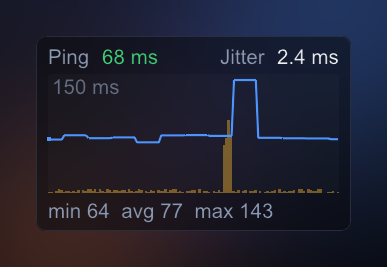
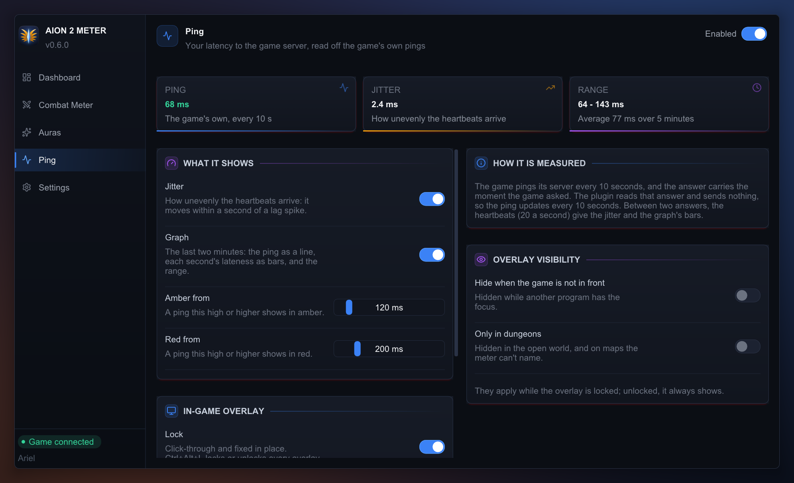

# 📶 Ping

**Your latency to the game server, its jitter, and a graph of the last two minutes, in
an overlay of their own.** One of the meter's three plugins (the others are the
[Combat Meter](../combat_meter/README.md) and [Auras](../auras/README.md)). Off until
you switch it on, at the top right of the app window's **Ping** page; switching it on
shows its overlay.

## The overlay

A third window you place like the meter's (unlock with Ctrl+Alt+L, drag, resize).
- **Ping:** the round trip of the game's own ping, in milliseconds. Green, then amber
  from 120 ms and red from 200 ms (both yours to set). It updates **every 10 seconds**:
  that is how often the game pings. "-" means there is none to show yet, or the last
  one is older than 25 seconds.
- **Jitter:** how unevenly the server's heartbeats arrive (it sends 20 a second). It
  moves within a second of a lag spike, between two pings.
- **The graph:** the last two minutes, a column a second. The blue line is the ping;
  the amber bars are how late that second's worst heartbeat came, so a spike shows the
  moment it happens. Under it, the least, average and most of the last five minutes'
  pings.
- **Hiding it:** locked, it can hide while the game is not in front, and outside
  dungeons, by its own settings. Jitter and the graph each have a switch.

## How it is measured, and how exact it is

**Nothing is sent.** The meter stays passive: it does not ping the server itself.
- **The game pings its server every 10 seconds,** and the server's answer carries the
  moment the game asked, on the game's own clock. That clock is your PC's performance
  counter, which any program can read. The plugin reads it as the answer arrives:
  the difference is the ping, the same sum the game does.
- **It includes the server's own time to answer,** as the game's figure would. It is
  the ping to the server you are on: entering a dungeon moves you to another one.
- **Through a ping reducer or VPN** it is still the whole trip, game to server and
  back, since it is the game's own question that is timed.
- **Which clock the game uses is inferred** from two captures, not confirmed against
  the game's own display. If it is another one, a ping would read as nonsense: the
  plugin then shows "-" rather than a wrong number, and its page says so. Jitter and
  the graph's bars do not depend on it.
- **Jitter** is the usual one (RFC 3550): the gap between two heartbeats' arrivals
  against the gap between their server times, smoothed over 16. The heartbeat's time
  is in whole milliseconds, so a calm line still reads 1 to 3 ms.
- **A capture played back** (`--replay`) has no ping: the counter it was recorded
  against is gone. Jitter and the bars still show.
- **Switched off**, it forgets what it knew.

## Configuration

Its keys live in `%APPDATA%\aion2-combat-meter\config.json`, beside the app's
([README, Configuration](../../README.md#%EF%B8%8F-configuration)). The page edits them
and saves as you go.

**ping**

| Key | Default | Meaning |
|---|---|---|
| `plugin_enabled` | false | The plugin's switch, which shows and hides its overlay. |
| `locked` | false | Click-through and fixed in place. |
| `opacity` | 0.55 | Background opacity, 0 to 1. The figures and the graph stay opaque. |
| `scale` | 1.0 | Size, 0.6 to 2.5, on top of the monitor's DPI scaling. |
| `x`, `y`, `width`, `height` | -1, -1, 210, 130 | Position and size in screen pixels. -1, -1 places it right of the meter overlay's default spot. |
| `show_jitter` | true | The jitter, beside the ping. |
| `show_graph` | true | The graph, and the least, average and most under it. |
| `warn_ms` | 120 | A ping this high or higher shows in amber, 10 to 1000. |
| `bad_ms` | 200 | A ping this high or higher shows in red; never under `warn_ms`. |
| `hide_when_game_unfocused` | false | Hide it while neither the game nor the meter's window is in front. Applies only while locked. |
| `show_in_dungeons_only` | false | Show it only in a dungeon (as the meter overlay's setting of that name). Applies only while locked. |

## For developers

The sums and their limits are in this plugin's [`AGENTS.md`](AGENTS.md).
`aion2meter-replay --ping` prints every pong of a capture and, per connection, how its
echo and the heartbeats spread.
